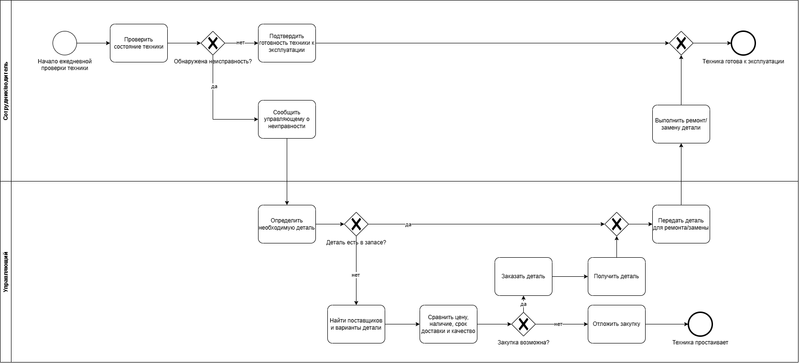
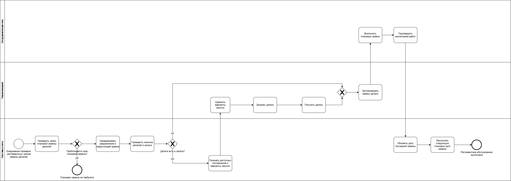
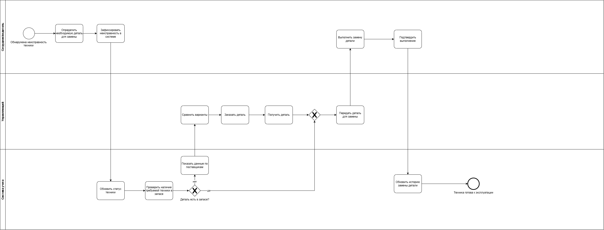

# Диаграммы бизнес-процессов

В разделе представлены BPMN-диаграммы процессов технического обслуживания и замены запасных частей сельскохозяйственной техники.

Диаграммы AS-IS отражают текущее состояние процесса, выявленное в ходе обследования.  
Диаграммы TO-BE отражают мои аналитические рекомендации по изменению процесса и не являются описанием уже внедрённого решения.

## AS-IS — обслуживание и ремонт техники

Диаграмма отражает текущий процесс обслуживания и ремонта техники.

Выявленные особенности процесса:

- ежедневная проверка состояния техники;
- передача информации о неисправности управляющему;
- ограниченный запас деталей;
- ручной поиск поставщиков при отсутствии необходимой детали;
- зависимость скорости ремонта от наличия и сроков поставки запчастей;
- риск простоя техники.

## TO-BE — плановая замена деталей

В рамках аналитических рекомендаций предложен проактивный процесс контроля регламентных замен.

Предлагаемые изменения:

- автоматический контроль сроков плановой замены;
- предварительное уведомление о необходимости обслуживания;
- проверка наличия требуемой детали;
- использование единой базы поставщиков;
- заблаговременная закупка отсутствующей детали;
- фиксация выполненной замены;
- автоматический расчёт следующей плановой даты обслуживания.

## TO-BE — внеплановый ремонт

Для работы с внеплановыми неисправностями предложен отдельный целевой процесс.

Предлагаемые изменения:

- фиксация неисправности и требуемой детали в системе;
- проверка наличия детали в запасе;
- предоставление информации о возможных поставщиках;
- централизованная история ремонта и замены деталей;
- сокращение количества ручных действий при поиске информации.

## Статус диаграмм

TO-BE представляет рекомендуемое целевое состояние процессов, сформированное по результатам обследования AS-IS.

Фактический эффект предложенных изменений требует проверки после реализации и внедрения решения.
